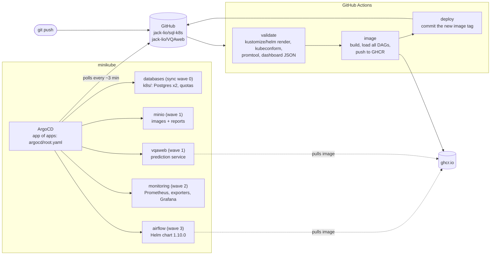
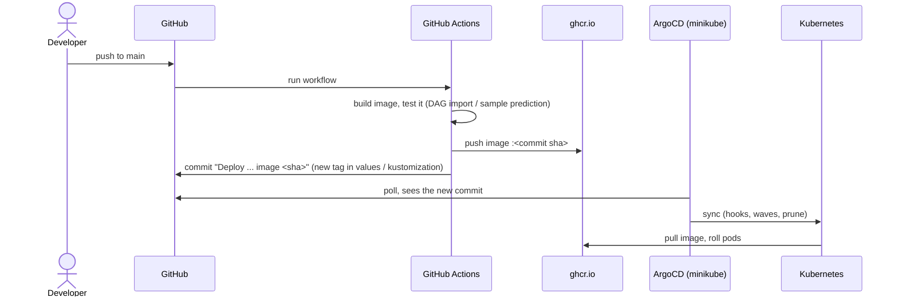
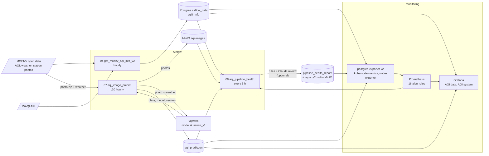

# AQI data platform on Kubernetes

Airflow pipelines that collect Taiwan air-quality data and station images,
run image-based AQI prediction, and check the health of the whole pipeline
with Claude. Deployed with GitOps: GitHub Actions builds and tests, ArgoCD
running in the cluster deploys.

## Architecture



The cluster pulls from GitHub, so it needs no inbound access: GitHub's
runners never reach minikube. Both repositories follow the same loop:



## Data flow



Stations: 基隆 (001), 林口 (009), 嘉義 (042), 安南 (045). Grafana compares
each prediction with the AQI that MOENV published for the hour the photo was
taken.

## Pipelines (dags/airflow-dags)

| DAG | Schedule | What it does |
|---|---|---|
| `get_moenv_aqi_info_v2` (04) | hourly | MOENV + WAQI AQI into Postgres `aqi4_info` |
| `aqi_image_predict` (07) | :20 hourly | station images to MinIO, weather values, prediction via `vqaweb`, into `aqi_prediction` (with `model_version`) |
| `aqi_pipeline_health` (08) | every 6 h | collects DAG, database, MinIO and alert signals; Claude reviews them; report to Postgres and MinIO |

## Prediction model

`vqaweb` (jack-lio/VQAweb) serves model A: frozen ImageNet MobileNetV2 image
features (PCA 64) plus weather, into a linear classifier over the six AQI
classes. Training and serving share one feature module, and CI fails if the
prediction on a sample image changes. Training data, results and how to
retrain: `backend/training/README.md` in that repository.

Every row in `aqi_prediction` records the `model_version` that produced it.
Rows before 2026-10-18 20:38 (Taipei) came from the earlier, untrained model
and are marked `legacy`; Grafana and DAG 08 leave them out of accuracy.

## Secrets

Nothing secret is committed (`.gitignore` excludes every `*.env`).
`bootstrap-secrets.sh` creates the Kubernetes Secrets from local files:

| File | Secret |
|---|---|
| `k3s/secrets.env` (`MOENV_API_KEY`, `WAQI_TOKEN`) | `airflow/airflow-dag-secrets` |
| `anthropic.env` (`ANTHROPIC_API_KEY`, optional) | `airflow/airflow-dag-secrets` |
| `minio/secrets.env` (generated) | `minio/minio-credentials`, Airflow connection `minio_aqi` |
| `monitoring/secrets.env` (generated) | `monitoring-db` in `monitoring` and `sql` |
| `ghcr.env` (`GHCR_USER`, `GHCR_TOKEN`, only for a private image; also uncomment `registry` in `airflow-values.yaml`) | `airflow/ghcr-pull` |
| `argocd/repo.env` (`GITHUB_USER`, `GITHUB_TOKEN`, only for a private repo) | ArgoCD repository credentials |

## New cluster

```bash
minikube start
./bootstrap-secrets.sh          # Secrets that git does not hold
./argocd/bootstrap.sh           # ArgoCD + the root Application
```

ArgoCD then deploys everything else, including the prediction service
`vqaweb` (namespace `default`) from the jack-lio/VQAweb repository.

## Day to day

- Change a DAG or the Dockerfile, push to `main`: CI builds and tests the
  image, pushes it, bumps the tag; ArgoCD rolls Airflow.
- Change a manifest, dashboard or alert rule, push to `main`: CI validates;
  ArgoCD applies it. Generated ConfigMaps get a new hash, so Prometheus and
  Grafana restart with the new files, and ArgoCD prunes the old ones.
- Pull requests run the same checks without pushing or deploying.
- Changed an env file: `./bootstrap-secrets.sh --restart`.

ArgoCD UI: `kubectl -n argocd port-forward svc/argocd-server 8081:80`, user
`admin`, password from
`kubectl -n argocd get secret argocd-initial-admin-secret -o jsonpath='{.data.password}' | base64 -d`.

## Roadmap

Known gaps, found by inspecting the running cluster (2026-10). Most are also
CKA topics, so they are done by hand, as practice.

| | Area | Gap | Plan |
|---|---|---|---|
| [ ] | Workloads | Both Postgres Deployments in `sql` have no requests/limits and no liveness probe; readiness probes time out (1 s) under load | Size from `kubectl top`, add `livenessProbe`, raise `timeoutSeconds` |
| [ ] | Scaling | `vqaweb` runs 1 replica, no HPA | metrics-server + HPA on CPU; `ignoreDifferences` on `spec.replicas` so ArgoCD doesn't undo it |
| [ ] | Networking | The minikube CNI doesn't enforce NetworkPolicy, so ArgoCD's policies have no effect | Cluster with `--cni=calico`; allow Postgres (5432) only from `airflow` and `monitoring` |
| [ ] | Availability | No PodDisruptionBudgets; single node | Multi-node profile, `cordon` / `drain`, PDB for `vqaweb` with 2 replicas |
| [ ] | Storage | No database backups | CronJob: `pg_dump` to MinIO daily, plus a tested restore |
| [ ] | Storage | Airflow worker and triggerer log PVCs are 100Gi each | Smaller PVCs (recreate the StatefulSets) |
| [ ] | Security | Pods in `sql`, `monitoring`, `default` use the `default` ServiceAccount | Own ServiceAccounts, `automountServiceAccountToken: false`, minimal RBAC |
| [ ] | Security | `vqaweb`, Postgres, Grafana, Prometheus run without `runAsNonRoot` | securityContext, read-only root filesystem with `emptyDir` for writable paths |
| [ ] | Platform | ArgoCD's own components have no resources | Patch in `argocd/install/kustomization.yaml` |
| [ ] | Model | USG and above are recalled poorly (USG 0.17); station 009 has no labels | More polluted hours and stations; retrain from photos collected in MinIO |

ArgoCD runs with `selfHeal`: a manual `kubectl edit` on anything it manages is
reverted within seconds. Try changes in a namespace ArgoCD doesn't manage
(`kubectl create ns practice`), then commit the final manifest.

`k3s/` holds the Raspberry Pi variant and is not deployed by ArgoCD.
